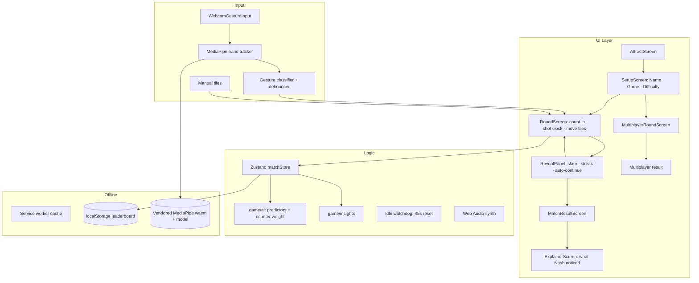

<div align="center">

# Nash

### Rock Paper Scissors against an AI that actually learns you, a web game with hand-gesture input that runs fully offline

_Play best-of-3, 7 or 11 against Nash, or go head to head with a friend. Throw with your hand through the webcam or tap a button. Nash starts blind, reads your habits mid-match with a transparent pattern model, and shows its work afterwards._


[Quickstart](#quickstart) · [Features](#features) · [How Nash Thinks](#how-nash-thinks) · [Architecture](#architecture) · [Offline & Kiosk Mode](#offline--kiosk-mode) · [Testing](#testing) · [Report an issue](https://github.com/ArrinPaul/rps-vs-ai/issues)

</div>

---

## About

**Nash** is an interactive, offline-first web game. A player picks a mode and plays rock paper scissors against an opponent that begins with no information and builds a model of that specific player as the match goes on.

The point is to make "an AI that learns you" tangible. Nash is not a scripted difficulty curve and not a trained neural network. It is a small, readable set of pattern detectors (move frequency, move-to-move transitions, cycles, win-stay/lose-shift), and the app says so. After every match, a "what I noticed" screen shows the real patterns Nash found in that player's throws.

The game is built for unattended kiosk use:
- **Zero network reliance:** After the first load it runs fully offline. The hand-tracking model and wasm runtime are vendored in `public/mediapipe`, the service worker caches the app shell, and all sound is synthesised with the Web Audio API.
- **Hands-free or touch:** Players can throw with an on-device webcam hand classifier or with on-screen buttons, and can switch between **Hand** and **Manual** mid-game.
- **Kiosk self-healing:** An automatic 45-second inactivity reset returns to the attract screen between players. Hands-free play counts as activity, so the timer does not fire mid-match.
- **Honest AI:** Nash's mood lines are gated on the same round threshold the model uses. It never claims to be "reading a pattern" before the model has started weighting against one.

> **Offline architecture:** No backend and no runtime internet connection are needed. Game state, the AI, audio, camera processing and the leaderboard all run inside the browser. Camera frames never leave the device.

---

## Features

| Area | What it does |
| :--- | :--- |
| **Three modes** | **vs AI** best-of-3, 7 or 11; **Survival** with limited lives and a best-streak target; **Two-player** duel on one screen |
| **Hand-gesture input** | On-device MediaPipe hand-landmark classifier reads rock, paper or scissors from the webcam, with a debouncer and automatic capture |
| **Manual input** | Big on-screen Rock / Paper / Scissors tiles, plus a **Hand \| Manual** switch to change input mid-game |
| **Two difficulties** | **Fair** adapts from round 4 and counters 65% of the time; **Ruthless** adapts from round 2 and counters 90% of the time |
| **Multi-strategy AI** | Cycle detection, first-order Markov transitions, recent-window frequency and a win-stay/lose-shift "psychologist" archetype |
| **Mind Reader gauge** | Live prediction bars and a per-round history strip showing what Nash expected versus what you threw |
| **Nash persona** | Animated avatar whose moods (`reading`, `locking-pattern`, `won-round`, `lost-round`, `reviewing`) track real match state |
| **"What I noticed" screen** | Post-match explainer naming the actual tendencies found, such as your most-played move or how you behave after a loss |
| **Reveal choreography** | Count-in, shot clock, tile slam, cracks, shake, streak meter and haptics, then auto-continue after 2.5 s |
| **Local leaderboard** | Best win-streak per match, stored in the browser's `localStorage` on that laptop |
| **Procedural audio** | Sound effects synthesised at runtime with zero audio assets; `M` mutes |
| **Kiosk controls** | Fullscreen button and `F` hotkey, 45 s idle reset, PWA manifest and offline service worker |

---

## How Nash Thinks

Nash's model is deliberately simple and inspectable. Predictors run in priority order and the first confident one wins:

1. **Cycle and sequence detection:** clockwise, counter-clockwise and oscillating patterns.
2. **Win-stay / lose-shift** (psychologist archetype): predicts how a player reacts to the last result, unless one move clearly dominates the recent window.
3. **First-order Markov transitions:** what this player tends to throw after their last throw.
4. **Frequency count** over the last 5 moves (ties favour the most recent).

Nash then plays the counter to its prediction with a probability set by difficulty, and plays randomly the rest of the time, so a player who varies their moves can never be read perfectly.

| | Random until | Counters its prediction |
| :--- | :--- | :--- |
| **Fair** | round 3 | 65% of the time |
| **Ruthless** | round 1 | 90% of the time |

For 3-round matches the warm-up is shortened so Nash still gets a chance to adapt. The adaptive gate is enforced in the AI's pick, not just the on-screen label, so Fair and Ruthless differ mechanically.

---

## Architecture



Core game logic (`src/game/ai.ts`, `match.ts`, `insights.ts`, `gesture.ts`) is pure and takes an injectable RNG, so Nash's behaviour is unit-tested without a browser or camera in the loop.

---

## Quickstart

```bash
git clone https://github.com/ArrinPaul/rps-vs-ai.git
cd rps-vs-ai
npm install
npm run dev
```

Open the printed local URL in Chrome. Allow camera access if you want hand-gesture input; the game works without it.

---

## Offline & Kiosk Mode

**Build once**, with internet access:

```bash
npm install
npm run build
```

This produces a self-contained static site in `dist/`. Do this once; afterwards the app works fully offline.

**Then run offline:** serve `dist/` locally and open it in Chrome:

```bash
npm run preview
```

No internet is needed. If `npm` is not available on the target machine, copy `dist/` across and serve it with any static server, for example `python -m http.server` from inside `dist/`.

| Task | How |
| :--- | :--- |
| **Go fullscreen** | Click **Fullscreen** (top right) or press `F`; `Esc` exits |
| **Mute / unmute** | Press `M` |
| **Reset between players** | Automatic: returns to the attract screen after 45 s of inactivity |
| **Verify offline** | After the first load, open DevTools → Application → confirm a service worker is registered, tick **Offline**, and reload |
| **Wrong round scored** | Use **Redo this pick** on the reveal screen to discard the round without a scored loss |

> The service worker registers in production builds only, so test offline behaviour against `npm run preview`, not `npm run dev`.

### Troubleshooting

- **App seems frozen:** reload (`F5` / `Ctrl+R`). The idle timer and service worker recover state.
- **Camera does not start:** check Chrome's camera permission for the page, or switch the input to **Manual**.
- **Hand tracking is slow to start the first time:** the first load fetches a ~14 MB wasm build and a ~8 MB model; the app warms it up on the round screen. After that it is cached.
- **Fullscreen exited unexpectedly:** click **Fullscreen** again.

---

## Leaderboard

Each completed match records its best win-streak in `localStorage` (key `rps-vs-ai:leaderboard`) on that laptop only. The top 5 show on the match-result screen. It resets only if the browser's site data for the app is cleared.

---

## Testing

```bash
npm run test    # Vitest + Testing Library
npm run lint    # oxlint
npm run build   # type-check (tsc -b) and production build
```

The suite covers the AI predictors, match and scoring rules, the gesture classifier, insights, the leaderboard, the Zustand store and the app flow.

---

## Scripts

| Script | Purpose |
| :--- | :--- |
| `npm run dev` | Vite dev server with hot reload |
| `npm run build` | Type-check and build to `dist/` |
| `npm run preview` | Serve the production build locally |
| `npm run test` | Run the Vitest suite |
| `npm run lint` | Lint with oxlint |

---

## Project Structure

```
src/
├── game/          # Pure logic: ai, match, insights, gesture (unit-tested)
├── store/         # Zustand match store
├── character/     # Nash persona and mood lines
├── camera/        # MediaPipe hand tracker and camera store
├── components/    # Screens and UI (attract, setup, round, reveal, result, explainer)
├── leaderboard/   # localStorage leaderboard
├── audio/         # Web Audio sound synthesis
├── hooks/         # Fullscreen and idle-reset hooks
└── data/          # Shared types
public/
├── mediapipe/     # Vendored wasm runtime and hand-landmarker model
├── sw.js          # Offline service worker
└── manifest.webmanifest
```

---

## Tech Stack

React 19, TypeScript, Vite 8, Tailwind CSS 4, Framer Motion, Zustand, MediaPipe Tasks Vision, Vitest, oxlint.

---

## Contributing

Issues and pull requests are welcome. Run `npm run test` and `npm run lint` before opening a PR.
